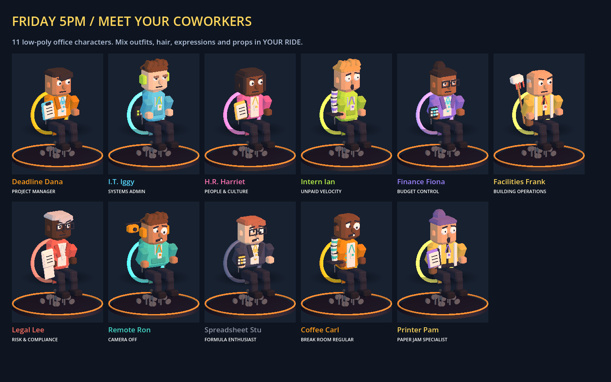

# Friday 5PM: Evacuation

> It's 4:59 PM Friday. Race your office chair to the parking lot. Last one buys beers.

A comedic multiplayer office-chair physics game built with Godot 4.7.1. Cross-platform support: macOS ARM, Windows, Linux, Android, iOS, and Web.

**Play in browser:** https://friday-evacuation.vercel.app (touch controls appear automatically on phones)

## Quick Start

### From Scratch

1. Install Godot 4.7.1:
   - macOS: `brew install --cask godot`
   - Download: https://godotengine.org/download

2. Clone and open:
   ```bash
   git clone https://github.com/jiracipika/friday-evacuation.git
   cd friday-evacuation
   open -a Godot project.godot  # macOS
   # Or: File → Open → Select project.godot in Godot editor
   ```

3. Press F5 or click "Play Scene" to start.

### Downloads

CI builds fresh artifacts on every push to `main` (see the `continuous` prerelease): macOS zip, Android APK, and a web build. The APK is debug-signed — install it directly; macOS builds are ad-hoc signed (right-click → Open on first launch).

### Controls

| Input | Steer | Boost | Brake or drift | Hop or interact | Item, scan, or fort | Pause |
| --- | --- | --- | --- | --- | --- | --- |
| Keyboard | WASD or arrows | Space | Shift | E | Q | Esc |
| Controller | Left stick | A / Cross or right trigger | Left trigger | X / Square | B / Circle | Start |
| Touch | Left thumbstick | Boost | Brake | Mode action | Mode action | Pause |

**A / Cross** uses coffee reserve while held. Press **E** or **X / Square** to grab and release cargo in Hauled, or collect an item and disguise in Shop & Seek. In the other modes this button hops. Use the camera bindings in Settings to change your view.

## Game Modes

- **Evacuation** sends up to eight riders racing down four office floors to the parking lot. Follow the checkpoint arrow, collect coffee and avoid the Roombas. Setup offers three routes and a Time Trial with a personal best ghost.
- **Hauled** gives the team three deliveries and a cargo integrity meter. Grab each package, steer it to the marked bay and ease off boost when carrying vulnerable cargo.
- **Shop & Seek** sends solo players through a shopping list while a security guard patrols. In LAN play, hiders get eight seconds to choose a disguise before the seeker can move or scan.
- **Pizza Colony** rewards staying on a pepperoni tile for three uninterrupted seconds. A second rider contests the claim. Spend cheese on forts and dodge the cutter. Claim the whole pie, be the last rider standing, or lead the remaining riders when time expires.

## Design Your Coworker

Open **Coworker** from the main menu to choose from eleven low-poly office
characters, including Spreadsheet Stu, Coffee Carl, and Printer Pam. Mix outfits,
hairstyles, hair and skin colors, body builds, expressions, outfit/accent colors,
and office props. **Rotate** lets you inspect the live 3D model;
**Surprise me** shuffles the design and **Reset preset** restores that coworker.
Edits save automatically for each character and travel with your avatar over LAN.
Use the same game build on every peer. Appearance changes are cosmetic; chair
skins still control the existing handling stats.



See [character graphics notes](docs/characters/README.md) for the shared model
builder, art captures, and verification commands.

## Multiplayer

### Local Wi-Fi (LAN)

**Host:**
1. Main menu → **Party** → **Host an office** — your LAN address is shown in the lobby ("your address: 192.168.x.x")
2. Friends scan, or type your address directly
3. Everyone readies up; host starts the match

**Join:**
1. Main menu → **Party** → **Join by address**
2. "SCAN LOCAL WI-FI" to discover hosts, or type the host's address
3. Ready up and wait for host to start

**Hotspot mode (no Wi-Fi):** one player hosts over a phone hotspot. Joiners get one-tap buttons for the common hotspot gateway addresses (Android `192.168.43.1` / `192.168.49.1`, iPhone `172.20.10.1`); discovery falls back to a subnet sweep when hotspot AP-isolation blocks broadcasts.

**In lobby & in match:** chat overlay and full avatar identity sync — name, color, rider character, and chair skin. The lobby names each player's rider/chair before START, and remote procedural models use those exact choices in the race. Traps, pickups, and stuns replicate to all peers. Late joiners drop straight into a running match with their avatar intact.

**Requirements:**
- All players on the same Wi-Fi network (or one phone's hotspot)
- macOS may ask for firewall permission for UDP ports 5007–5009
- Host and clients need compatible Godot version (4.7.1)

## Performance Settings

Optimized for mobile performance and the MacBook Air baseline. Adjust in Settings:

- **Low**: Disabled fog, reduced particles, baseline ambient
- **Medium**: Enabled fog, standard particles
- **High**: Enabled fog + glow, full particles, enabled shadows

Distant floors are culled automatically during races (adjacent floors drop their dynamic lights). Default is optimized performance (Low/Medium baseline).

## Project Structure

```
friday-evacuation/
├── project.godot           # Project metadata and config
├── export_presets.cfg      # macOS / Android / Web export presets
├── scenes/                 # Scene files (.tscn)
│   ├── Main.tscn          # Main menu
│   ├── Evacuation.tscn    # Primary race mode
│   ├── Hauled.tscn        # Cargo delivery
│   ├── ShopSeek.tscn      # Grocery hide & seek
│   ├── PizzaColony.tscn   # Pizza survival
│   └── objects/           # Reusable objects
│       └── SabotageTrap.tscn
├── scripts/                # GDScript logic
│   ├── GameManager.gd     # Global state and mode enum
│   ├── Network.gd         # LAN multiplayer and ENet (roster, chat, world sync, layout sync)
│   ├── AudioManager.gd    # Procedural audio and bus control
│   ├── PlayerChair.gd     # Player physics controller (drift, brake, boost, mash-recover)
│   ├── Evacuation.gd      # Primary mode logic
│   ├── LevelLayouts.gd    # Map layout data tables (Open Plan / Cubicle Maze / Executive)
│   ├── InputPrefs.gd      # Input settings: sensitivity, schemes, remaps, rumble
│   ├── Lobby.gd          # Multiplayer lobby
│   ├── MobileControls.gd # Touch controls
│   └── ...
├── .github/workflows/      # CI: exports + Vercel deploy on push
├── PLAYTEST.md            # Human QA checklist (feel, controller, touch, LAN)
└── ROADMAP.md            # Detailed implementation roadmap
```

## Development

### Running Tests

The full serial verification ladder (32 suites):

```bash
bash scripts/run_ladder.sh
```

Individual suites (all under `scripts/`):

```bash
godot --headless --path . --script scripts/BootTest.gd        # compile + scene loads
godot --headless --path . --script scripts/NetworkTwoPeerTest.gd  # real ENet host+client
godot --headless --path . --script scripts/LevelClearTest.gd  # bot drives floor 1 → exit
bash scripts/run_multiplayer_sync_test.sh                     # two-process sync (gold standard)
godot --headless --path . --quit-after 3                      # full project boot
```

### Architecture

**Autoloads:**
- `GameManager`: Mode selection, player data, global state
- `Network`: LAN discovery, ENet hosting/joining, roster, ready-state, chat, world-event replication, host-authoritative match start (carries the host's map layout)
- `AudioManager`: Pooled procedural audio, AudioServer bus control

**Key Design Decisions:**
- Procedural generation over external assets (meshes, materials, textures — including runtime normal maps — and audio)
- Stable cross-platform GL Compatibility renderer with expensive effects gated by quality settings
- Frame-rate independent smoothing (exponential lerp with delta)
- Host-authoritative LAN multiplayer: roster/readiness/match-start/layout are server-authoritative; player movement is unreliable-snapshot with interpolation
- Reusable UI components (`ModeHUD`, `ModeCard`, `Lobby`, `PreMatchModal`)
- LAN multiplayer before Steam integration

### Contributing

1. `git pull --ff-only` before starting work
2. Always run the ladder after changes
3. Submit changes for review in a pull request
4. Commit with descriptive messages
5. Push after verifying

## Known Limitations

- Steam integration is deferred — LAN is the current multiplayer focus
- Real-device mobile QA not yet performed (touch layout, controller feel, rumble)
- Two-machine Wi-Fi QA pending over real hardware (software-verified via loopback two-process tests)
- Procedural character/prop art is intentionally lightweight and can be replaced by authored assets later

## License

Private repository — jiracipika/friday-evacuation

## Credits

Built with Godot 4.7.1. Procedural content, design, and development by Hermes Agent. Additional polish and visual treatment by GLM 5.2.

---

**Current Version:** 0.1.0  
**Godot Version:** 4.7.1  
**Status:** All four modes have playable, software-verified loops; LAN multiplayer verified in-process (roster/chat/world sync/layout sync); real-device and two-machine LAN QA pending
