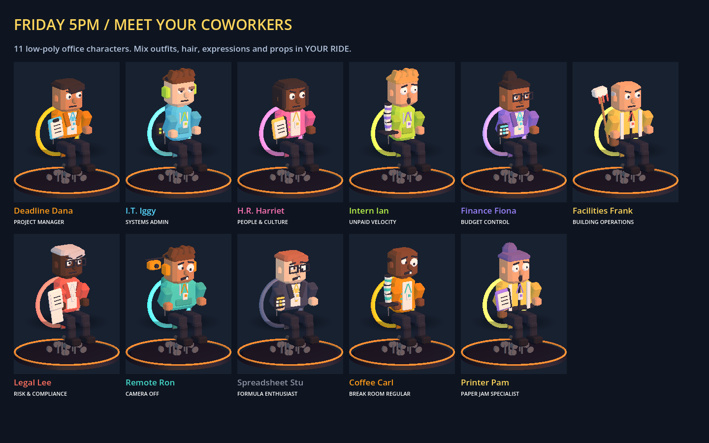
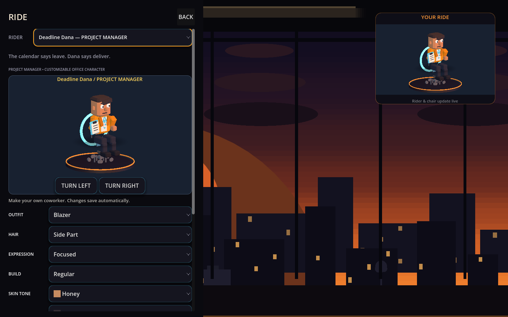
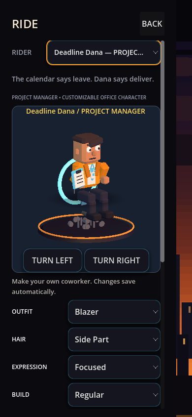
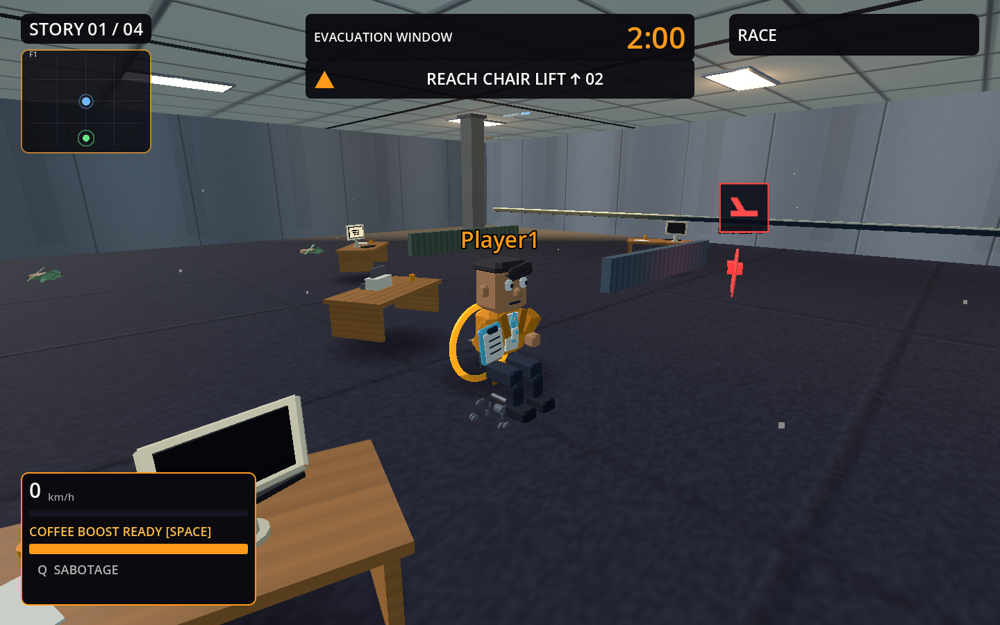

# Low-poly office characters

Eleven coworkers now use one flat-shaded model builder in gameplay, multiplayer,
and both menu previews. Angular heads and bodies, bent seated legs, chunky shoes,
hair silhouettes, tailored outfits, badges, and readable office props replace
the shared capsule rider. Spreadsheet Stu, Coffee Carl, and Printer Pam add
crossed eyes, a crooked single-tooth grin, and a panicked expression.



The YOUR RIDE screen includes an always-available 3D preview, turn controls, nine
cosmetic selectors, shuffle, and reset. Each preset keeps its own saved overrides.
Unknown save or RPC values are discarded through a bounded option catalog;
missing overrides retain preset defaults. LAN identity and roster messages carry
the sanitized design before the remote chair builds its visual model.

The default imported chair used to hide the selected rider behind its baked
worker. It now hides only the baked worker, keeps the customizable rider visible,
stands the chair's -Z-up geometry upright, and tints the cushion material surface.
Duplicate procedural wheels are hidden on that chassis, and each visual base
aligns with the physics capsule's bottom so the character rests on the floor.
Collisions, movement, and chair-skin stats remain governed by the existing game.

## Implementation

- `scripts/CharacterRoster.gd`: names, IDs and office identities.
- `scripts/CharacterDesign.gd`: options, defaults and save/RPC sanitization.
- `scripts/OfficeCharacterVisual.gd`: shared beveled, flat-shaded meshes and props.
- `scripts/CharacterDesigner.gd`: live preview and editing controls.
- `GameManager`, `Network`, `Evacuation`, `PlayerChair`: persistence and identity.

Riders stay below 6,000 triangles, reuse mesh/material resources, and add no
colliders, lights, realtime shadows, or face textures. Eye wobble and head tilt
use transforms. Hidden menu previews stop rendering; preview chairs do not run
physics. The character designer uses 48px controls inside the existing scrollable
menu at desktop and phone widths.

## Validation and captures

```bash
bash scripts/run_ladder.sh
bash scripts/run_multiplayer_sync_test.sh
godot --headless --path . --script scripts/CharacterDesignSmokeTest.gd
```

`CharacterDesignSmokeTest` checks save/load, independent preset edits, UI controls,
reset behavior, triangle budgets, outward mesh normals, and visible gameplay
integration. `FaceSmokeTest` checks mesh eyes and inertial pupil motion.
`LanAvatarSyncTest` checks sanitized designs on real remote chairs; the two-process
test checks custom designs over ENet in both directions.

Captures use the real GL Compatibility renderer, not the headless fallback:

```bash
godot --path . --rendering-method gl_compatibility --audio-driver Dummy \
  --script scripts/CharacterArtCapture.gd -- --lineup
godot --path . --rendering-method gl_compatibility --audio-driver Dummy \
  --script scripts/CharacterArtCapture.gd
godot --path . --rendering-method gl_compatibility --audio-driver Dummy \
  --script scripts/CharacterArtCapture.gd -- --mobile
godot --path . --rendering-method gl_compatibility --audio-driver Dummy \
  --script scripts/CharacterArtCapture.gd -- --race
```






