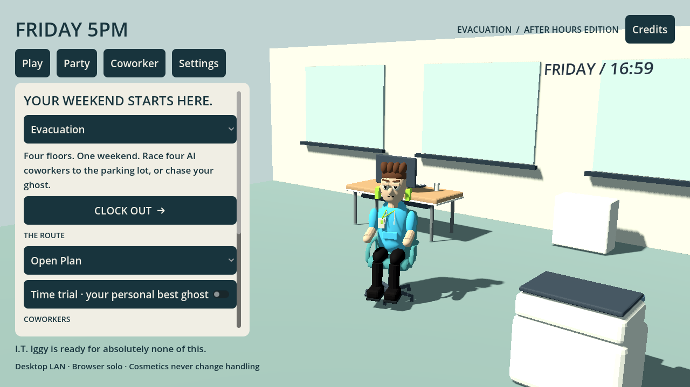
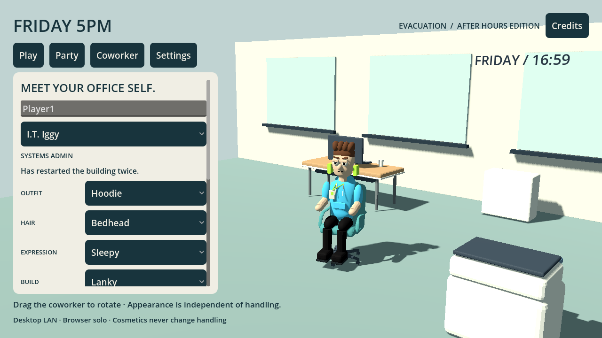
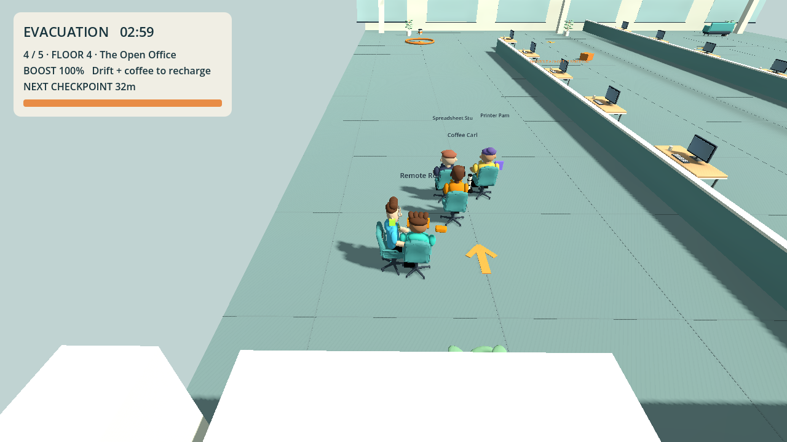
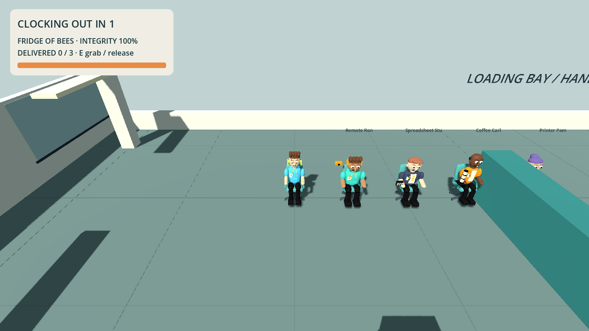
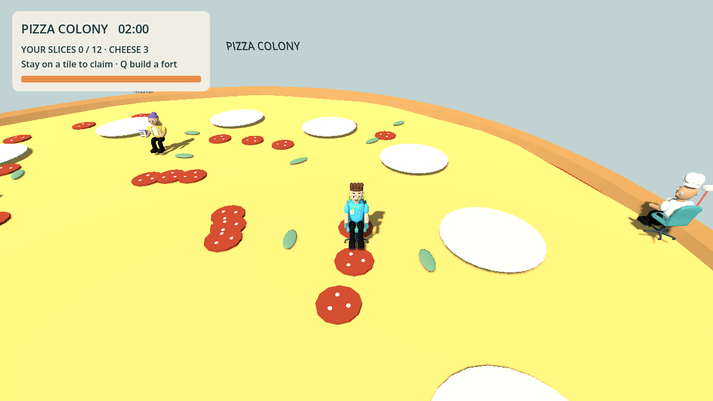
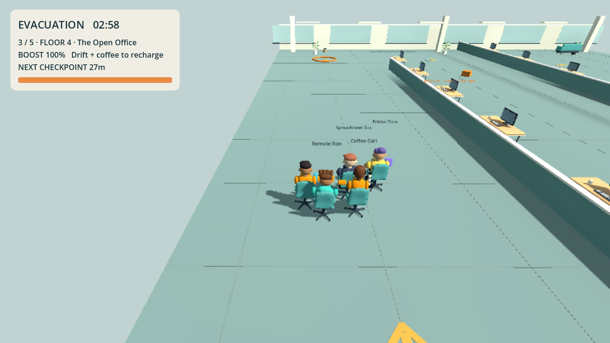

# Overhaul verification — 2026-10-30

| Check | Result |
| --- | --- |
| Existing ladder | 81 / 81 suites, 83 / 83 phases passed |
| Settings, accessibility and bindings after integration | Both affected four-suite subsets passed |
| Character/chair combinations | 66 combinations; maximum 15,542 triangles; modular/animation checks passed |
| Shared motor | Boost bounds, drift recharge, three profiles, impact immunity, hop and state restore passed |
| Normal AI courses | All five coworkers finished Open Plan, Cubicle Maze and Executive Suite |
| Hard AI | Open Plan completed with desk-hop shortcuts |
| Time trial | Solo course finished; 973 versioned ghost frames captured |
| Hauled | Three deliveries through real collision geometry completed |
| Shop & Seek | Five-item shopping list completed through movement/interactions |
| Pizza Colony | Territory claim, cheese expenditure, fort creation and bounded round passed |
| Separate-process ENet | Host authority, predicted movement settling, readiness and protocol refusal passed |
| Offline lighting | Three courses baked using Vulkan; saved scenes rendered with GL Compatibility |
| Visible frame sample | 358,428 submitted primitives, 455 draw calls, including shadows/UI, at the starting grid |
| Exports | Native Linux and single-threaded Web export succeeded |
| Browser | Chromium WebGL launch and driving capture; no console/page errors |

The web export including engine, shared assets and baked courses is approximately
49.3 MiB before HTTP compression. Actual device frame rates are unverified.
Captures use cloud Mesa software rendering; they do not establish M1 Air,
phone, router/discovery or human multiplayer playtest results.

## Captures

