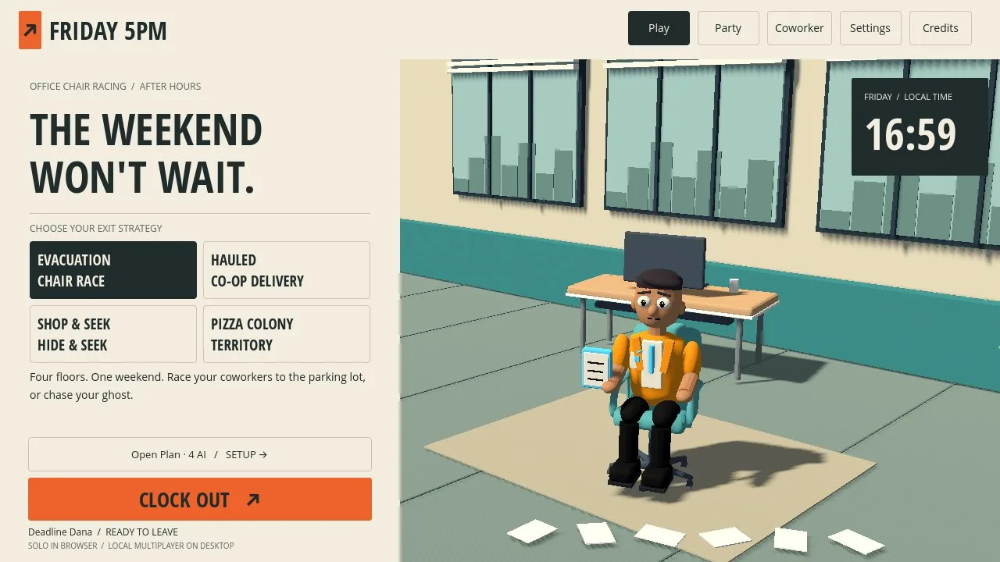
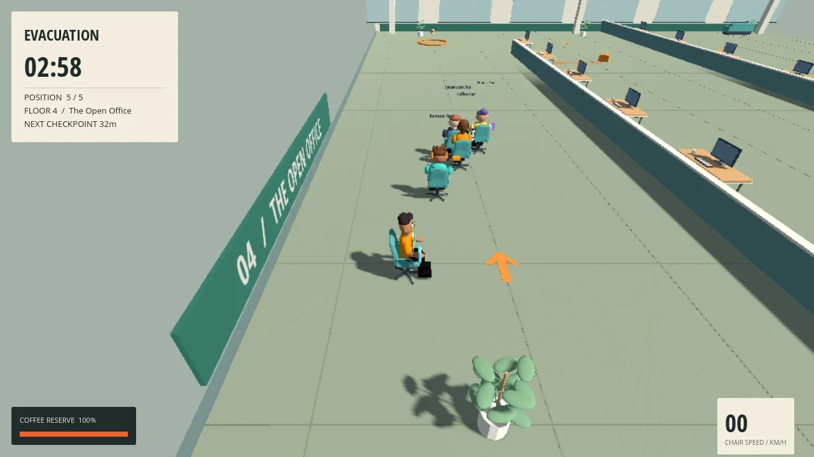
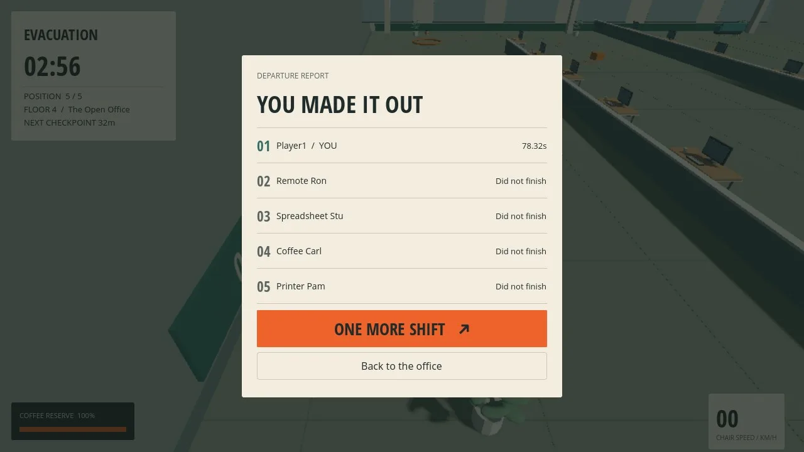

# Friday 5PM visual redesign

The game takes its cues from an office at closing time. Warm paper carries the interface, dark ink organizes information, and safety orange marks the main action and course warnings.

The live launch screen shows all four modes and keeps Clock Out available while players browse. Race options live in setup. The Coworker tab keeps the live rider preview and the existing presets, chair skins, and appearance options.



Department colors, ramp signs, and loading bay and shop markings distinguish the spaces. The race HUD separates the timer and objective from chair speed and coffee reserve.



The departure report highlights the local player, places and finish times.



Run the visual UI regression check with:

```sh
godot --headless --path . --script tools/overhaul/VisualRedesignCheck.gd -- --test-mode
```

Desktop screenshots were captured in Godot 4.6.3 using the generated courses. The existing avatar and baked course assets are retained in the repository.
