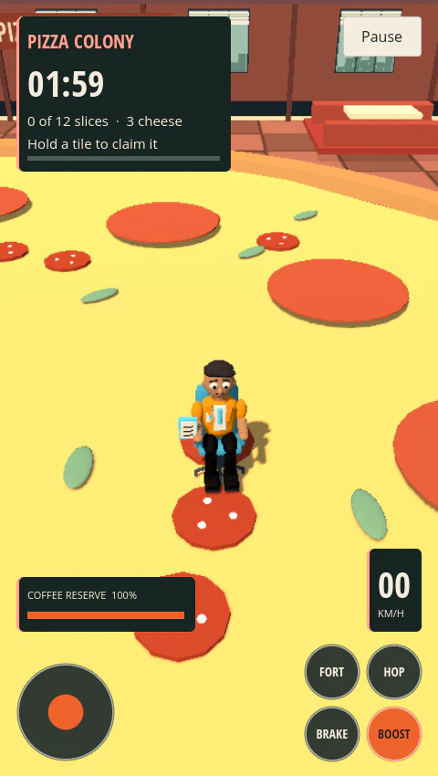

# Friday 5PM visual redesign

The launch screen shows key art, a short description, and launch options for each of the four modes. The Coworker tab uses a live 3D preview for rider customization, and the chair upholstery uses the rider’s accent colour across detail levels.


The office floors have department signs and distinct floor finishes. Hauled takes place in a freight bay, Shop & Seek has stocked racks and cross-aisles, and Pizza Colony is set in a tiled pizzeria.


The in-match display pairs a mode-specific objective with an arrow and distance for the next checkpoint, cargo load, or shopping-list item. Pizza Colony shows capture progress on the tile itself. The touch layout supports steering and holding boost or brake at the same time.



Run the scene, simulation, and LAN checks with:

```sh
python3 tools/overhaul/verify.py
```

Screenshots were captured in Godot 4.7.2 with its Compatibility renderer.
